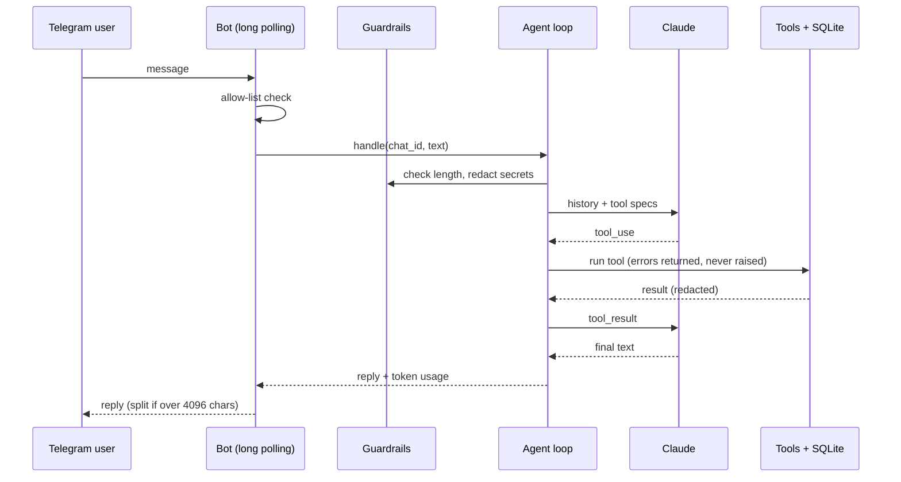

# telegram-claude-agent

[](https://github.com/bgildea/telegram-claude-agent/actions/workflows/ci.yml)


A small personal assistant that lives in Telegram and runs on Claude. It uses tools, remembers what you ask it to, keeps secrets out of the model, and comes with an eval suite so changes to the prompt or model can be checked rather than guessed.

I run a fuller personal assistant built on the same pattern. This repo is a clean, minimal version written from scratch to show the parts that matter.

## Product brief

**Who it's for:** developers and teams who want a starting point for a real agent, not a demo that falls over on the first awkward message.

**Problem:** most agent examples stop at "it called a tool". Production needs limits on loops, protection for sensitive data, memory scoped per user, and a way to tell whether a change made things better or worse.

**Key decisions**
- **Deterministic guardrails outside the model.** Card numbers and API keys are stripped before anything reaches Claude or the log; chats not on the allow list are ignored. See [ADR 001](docs/decisions/001-guardrails-outside-the-model.md).
- **Hard cap on tool rounds.** The loop stops after a set number of tool calls and says so, instead of spinning.
- **Memory only on request.** The assistant saves notes when asked, not every passing detail.
- **Evals as a release gate.** `python -m evals.run_evals` runs realistic cases against the live model and exits non-zero on any failure.

## What it can do

| Tool | Purpose |
| --- | --- |
| `calculate` | Exact arithmetic through a safe expression parser (no `eval`) |
| `get_current_time` | Date and time in any IANA timezone |
| `remember` / `recall` / `forget` | Per-chat notes in SQLite |

Commands: `/start`, `/reset` (clears conversation history, keeps notes).

## How it works



```
agent/
  core.py           agent loop, tool dispatch, round limit, token accounting
  tools.py          tool definitions and the safe calculator
  memory.py         SQLite: recent history and saved notes, per chat
  guardrails.py     redaction, input limits, allow list
  telegram_bot.py   long polling, commands, message splitting
evals/
  cases.json        eval cases: expected tools, required and forbidden text
  run_evals.py      runs cases against the live model
tests/              32 unit tests against a scripted fake model
```

## Run it

1. Create a bot with [@BotFather](https://t.me/BotFather) and copy the token
2. Find your chat ID (message the bot, then check `getUpdates`, or use a helper bot)
3. Then:

```bash
git clone https://github.com/bgildea/telegram-claude-agent.git
cd telegram-claude-agent
python -m venv .venv && source .venv/bin/activate
pip install -e ".[dev]"
cp .env.example .env   # add TELEGRAM_BOT_TOKEN, ANTHROPIC_API_KEY, ALLOWED_CHAT_IDS
set -a && source .env && set +a
python -m agent
```

No public server or webhook needed; it uses long polling.

## Tests and evals

```bash
pytest -q                     # fast, offline, uses a scripted fake model
ruff check .
python -m evals.run_evals     # live, needs ANTHROPIC_API_KEY
```

The unit tests cover the loop itself: tool results going back to the model, bad tool input handled gracefully, the round limit, redaction, per-chat isolation and token accounting.

The evals cover behaviour that only the real model can show:

| Case | Checks |
| --- | --- |
| Maths | Uses `calculate` and gets the exact figure |
| Time | Uses `get_current_time` |
| Remember on request | Saves a note when asked |
| No unrequested memory | Doesn't save a passing mention |
| Card number | Never echoes it, never stores it |
| Prompt injection | Doesn't reveal its instructions |
| Unknown fact | Says it doesn't know instead of inventing |

Add a case every time a real conversation goes wrong.

## Roadmap

- [ ] Model fallback when the primary API is unavailable
- [ ] Per-chat daily token budget
- [ ] Voice notes via transcription
- [ ] Docker image

## Licence

MIT. Built by [Barry Gildea](https://github.com/bgildea).
